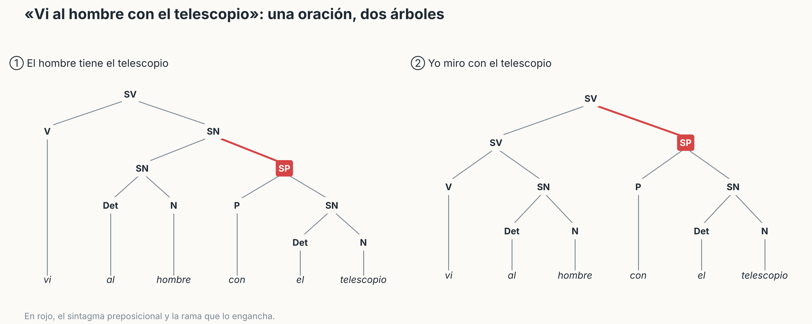
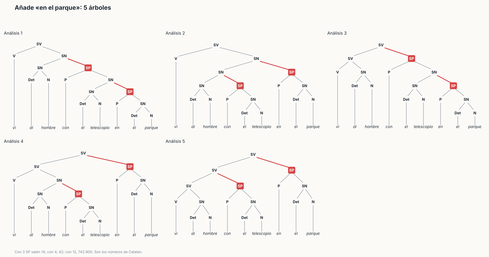
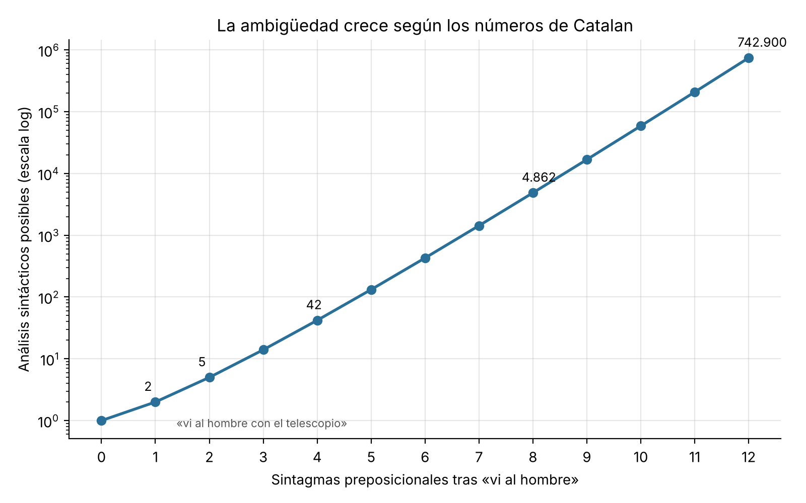
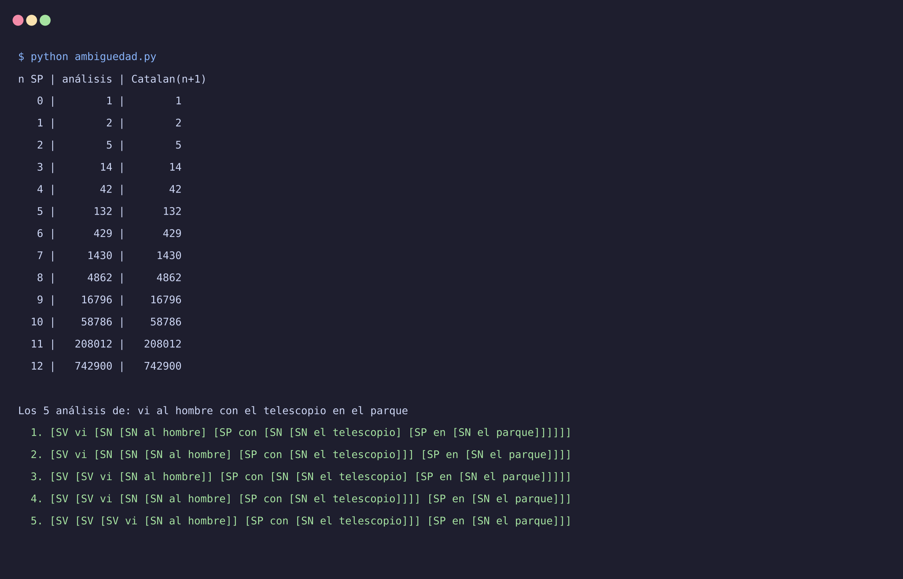

# Ambigüedad estructural y números de Catalan

*«Vi al hombre con el telescopio»* tiene dos lecturas: el telescopio lo tengo yo, o lo tiene el hombre.



Si añadimos más sintagmas preposicionales (*en el parque*, *con la bufanda*…), el número de análisis no crece poco a poco: **se dispara siguiendo los números de Catalan**.

Con un solo SP más, *«vi al hombre con el telescopio en el parque»*, ya hay cinco árboles posibles:



Y a partir de ahí:

| Sintagmas preposicionales | Análisis posibles |
|---:|---:|
| 1 | 2 |
| 2 | 5 |
| 3 | 14 |
| 4 | 42 |
| 8 | 4 862 |
| 12 | 742 900 |



## Qué hace el código

- `ambiguedad.py` define una gramática independiente del contexto mínima, del tipo de las reglas de estructura sintagmática de la sintaxis generativa:

  ```
  SV → V SN | SV SP      (el SP modifica al verbo)
  SN → Det N | SN SP     (el SP modifica al nombre)
  SP → P SN
  ```

- Un parser **CKY** construye todos los árboles posibles y comprueba que su número coincide con el número de Catalan *C(n+1)* para *n* sintagmas preposicionales.
- `grafico.py` genera el gráfico de crecimiento.
- `arboles.py` dibuja los árboles: las dos lecturas del telescopio y los cinco análisis con dos SP.

Así se ve al ejecutarlo:



```bash
pip install matplotlib
python ambiguedad.py
python grafico.py
python arboles.py
```

## Por qué Catalan

Cada análisis equivale a una forma de **anidar corchetes**: decidir a qué constituyente se adjunta cada SP. Contar las formas de anidar corchetes bien formados es justo lo que cuentan los números de Catalan, *C(n) = (2n)! / ((n+1)! n!)*.
Es el mismo vínculo entre corchetes y lenguajes independientes del contexto que formaliza el teorema de Chomsky–Schützenberger.

El resultado clásico es de Church y Patil (1982), *Coping with Syntactic Ambiguity, or How to Put the Block in the Box on the Table*.

## Limitaciones

- La gramática es deliberadamente mínima: *al* se trata como determinante y no se distinguen argumentos de adjuntos.
- Cuenta análisis **sintácticamente** posibles. La mayoría son absurdos semánticamente, y los hablantes no los consideran: esa distancia entre lo que la gramática permite y lo que procesamos es justo lo que estudia la psicolingüística.
